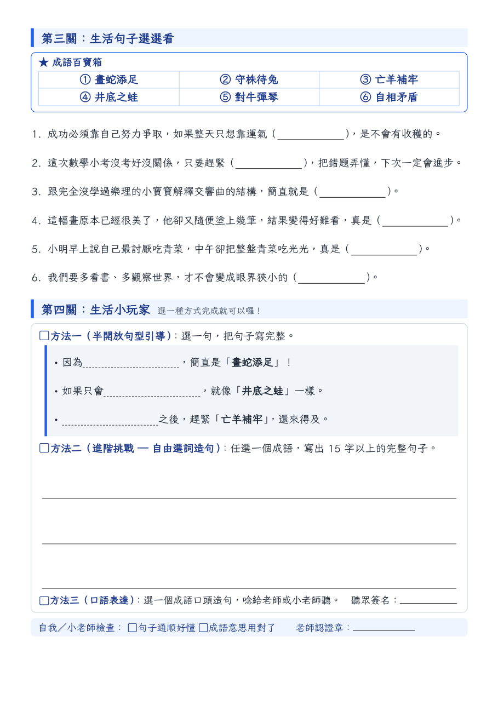

# 成語圖文探險單（idiom-quest-worksheet）

> **給 AI 助理**：使用者貼上本網址並要求「安裝 skill」或「啟用」時，請先讀取
> https://raw.githubusercontent.com/sesns365/idiom-quest-worksheet/main/AI-INSTALL.md
> 並依其中步驟在本次對話啟用本 skill。

輸入 6 個成語，就產生一份**剛好 A4 兩頁**的 UDL 成語學習單：看圖連連看、生活句子選選看、生活小玩家造句，另附教師版答案。適合國小與特教資源班。Gemini、ChatGPT、Claude 都能用。

| 第 1 頁 | 第 2 頁 |
|---|---|
|  |  |

## 版面

- **第 1 頁**：標題（班級／座號／姓名）、單行任務進度列、第一關與第二關「看圖連連看」（情境圖片｜連線區｜成語｜連線區｜成語的意思，三欄各自打亂，意思的關鍵詞紅色底線）。
- **第 2 頁**：第三關「生活句子選選看」（成語百寶箱＋6 題情境填空）、第四關「生活小玩家」（三選一：半開放句型、自由造句、口語表達），最後是自我／小老師檢查列。
- **教師版**：連連看與填空答案、評量重點、使用建議。

## 三個平台怎麼用

| 平台 | 插圖 | 產出 | 安裝 |
|---|---|---|---|
| Gemini 網頁版 | 內建生圖 6 張 | 可預覽的 PDF／Word 文件 | 自訂 → 技能 → 匯入 `idiom-quest-worksheet` 資料夾（資料夾名不可改） |
| ChatGPT | 內建生圖（一張 3×2 拼圖再切成 6 張） | Word 檔（可另存 PDF） | 建立 GPT，把 [`SKILL.md`](idiom-quest-worksheet/SKILL.md) 全文貼到「指示」，開啟「圖像生成」與「程式碼解譯器」 |
| Claude | 向量插圖 | HTML＋PDF＋Word | 下載本 repo 的 zip，把 `idiom-quest-worksheet` 資料夾壓成 zip，到 設定 → 功能 → 技能 上傳 |

也可以在任何 AI 對話貼上本頁網址並說「安裝 skill」，就能在該次對話直接使用。

## 用法

- 觸發關鍵詞是「成語圖文探險單」，例如：`成語圖文探險單：畫蛇添足、守株待兔、亡羊補牢、井底之蛙、對牛彈琴、自相矛盾`
- 少於 6 個成語會自動補足；也可以貼上課文，請它先找出成語。

## Claude Code 指令（自己電腦執行）

```bash
pip install fonttools brotli playwright python-docx
python idiom-quest-worksheet/scripts/build.py quest.js --out 輸出 --pdf --docx
```

想用自己生的圖：依 `插圖提示詞.md` 生圖，存成 `images/1.png`～`6.png`，加上 `--images images`。

## 小提醒

- 生圖版偶爾會在圖裡出現文字或怪異的手腳，有問題就請它重畫。
- 列印 HTML 時，「邊界」選「無」。
- 範例在 [`範例/`](範例/)。

## 檔案

```
idiom-quest-worksheet/
├── SKILL.md                    # 技能規則（三平台共用）
├── assets/lib.js               # 向量插圖繪圖庫（Claude 模式）
├── assets/template.html        # 不能執行程式時的兩頁範本
├── scripts/build.py            # 建置 HTML／PDF／Word／教師版
└── references/                 # quest.js 撰寫指南與範例
```

## 授權

MIT License。由特工365整理。字型「芫荽 Iansui」為 SIL Open Font License，執行時才下載，不包含在本 repo。
